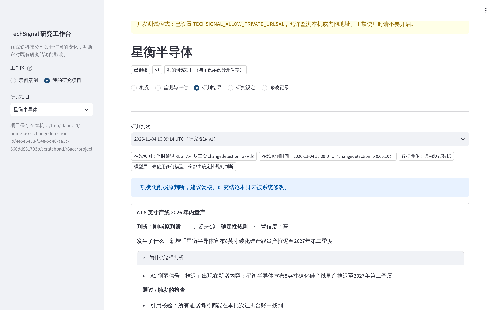

# TechSignal

**用证据跟踪硬科技公司的公开信息变化，判断它对既有研究结论的影响。**

> *English summary* — TechSignal turns raw web-page changes captured by [changedetection.io](https://github.com/dgtlmoon/changedetection.io) into cited, reviewable research judgements: does a new change **support**, **weaken** or **not affect** an existing investment thesis, or is the evidence **insufficient**? It keeps an evidence ledger, tracks judgements across batches, runs a bounded, deterministic evidence-gathering step with real tools (allow-listed, budgeted, fully traced), and ships a Chinese browser workbench where a non-programmer can create a research project from plain text and run one monitored check against their own changedetection.io. An optional OpenAI-compatible model layer gives per-assumption suggestions that are validated and gated by the rules; **no real model has been called in this project** (no authorised service), and it is a research prototype, not a production service.


## 1. 解决什么问题

研究人员跟踪一家硬科技公司时，常常要回答：「官网、文档、仓库里**这条新变化**，会不会动摇我之前的判断？」

网页监控工具只能告诉你「页面变了」。TechSignal 进一步回答下面这些问题，并且每个回答都给出证据编号：

- 这条变化与哪一条**研究判断、哪一条关键假设**有关？
- 它是**支持**、**削弱**、**无关**，还是**证据不足、需要核实**？
- 证据来自谁？等级如何？是什么时候**发布**的，又是什么时候被**抓取**的？
- 遇到不确定的情况，系统**主动查了什么**？查到了没有？**还剩什么需要人来核实**？

系统永远不会自动修改研究结论。「削弱」只会触发「建议研究负责人复核」。

## 2. 与 changedetection.io 的关系与区别

| | changedetection.io（上游，独立项目） | TechSignal（本项目） |
|---|---|---|
| 回答的问题 | 网页变了什么 | 这对研究判断意味着什么，证据够不够 |
| 输入 | 网页、RSS、PDF | changedetection.io 的变化数据（REST API） |
| 输出 | 快照、差异、通知 | 研判结论、证据台账、跨批次历史、补证轨迹、中文速览 |
| 状态 | 监测项与快照 | 研究判断（只读）、证据台账、研判历史 |

**依赖关系：** TechSignal 通过 HTTP 读取一个**正在运行的** changedetection.io 实例，本仓库不包含、也没有修改它的源码。没有 changedetection.io 时，TechSignal 照样可以安装、测试，并打开已保存的真实案例。抓取网页、存储快照、计算差异，都是 changedetection.io 作者和贡献者的工作；本项目只负责其后的研判部分。

## 3. 本项目独立实现的部分

| 模块 | 作用 |
|---|---|
| `techsignal/adapters/cdio.py`、`cdio_client.py` | 按 changedetection.io 的 API 契约校验并解析变化报告；HTTP 客户端（鉴权、超时、重试、分页、错误分类） |
| `triage.py`、`rules.py`、`assess.py` | 降噪；去重（按「内容 + 研究对象」，高等级来源不会被低等级来源当作重复）；实体、主题和关键假设信号规则（否定语境、删除内容不会给出方向）；证据等级闸门；来源冲突不自动裁决 |
| `store.py`、`pipeline.py` | 证据台账（JSONL，校验通过后才写盘）；跨批次研判历史 |
| `brief.py`、`validate.py`、`provenance.py` | 中文速览；引用完整性校验（事实没有来源就报错）；来源声明按运行元数据生成 |
| `verify/` | **有界补证**：确定性触发与规划；白名单（每次重定向都重新检查）；每项最多 3 次调用；超时、重试、去重；工具输出只当作数据；完整执行轨迹 |
| `providers.py` | 模型层：OpenAI 兼容接口，R6 起支持「一次调用、逐条假设给建议」，带变化类型、调用上限、输入长度上限、超时和用量记录。只用 Mock 和本地协议桩测试过，**没有调用过真实模型** |
| `projects.py`、`project_monitor.py` | R6：浏览器里用文字新建研究项目（版本记录、冲突保护、与示例案例隔离）；连接用户自己的 changedetection.io，确认后建立监测，手动检查一次并研判 |
| `eval_r6.py`、`eval/` | R6：独立评测集，人工标注 / 规则层 / 协议桩 / 真实模型分列 |
| `workbench/` | 全中文 Streamlit 研究工作台 |
| `live.py`、`fixtures.py` | 开发工具：启动真实 changedetection.io 做端到端验证；用上游的报告生成器制作测试数据 |

## 4. 架构与数据流

```
                 changedetection.io（外部服务，可选）
                         │  GET /api/v1/changes（或已保存的响应）
                         ▼
 ChangesReport ─► 适配器校验 ─► 降噪 / 去重 ─► 证据台账（编号、来源、等级、可追溯路径）
                                          │
                     研究判断（JSON，只读） ─┤
                                          ▼
                      规则研判：支持 / 削弱 / 无关 / 证据不足
                      ├─ 证据等级闸门（C/D 级不能单独定向）
                      ├─ 同批次冲突与跨批次历史比对（不自动裁决）
                      └─ 有疑点 ─► 有界补证（白名单内的真实工具调用）
                                     └─► 新证据独立编号 ─► 用同一套规则复评
                                          ▼
          中文速览 + 引用校验 ─► 原子提交输出 ─► 研究工作台（浏览器）
```

## 5. 快速开始（干净环境）

需要 Python 3.11 或以上版本。不需要 Docker、模型密钥或 changedetection.io。

```bash
git clone <本仓库地址> TechSignal && cd TechSignal
python -m venv .venv && . .venv/bin/activate
pip install -e ".[test,ui]"
```

运行离线测试：

```bash
python -m pytest
```

启动研究工作台，然后在浏览器打开 http://localhost:8501：

```bash
python -m techsignal.workbench
```

在工作台里：
1. 选择「Tenstorrent Blackhole：跨批次跟踪」案例；
2. 依次查看总览、变化时间线、补证过程、证据详情；
3. 在「管理层速览」下载中文速览；
4. 把「数据来源」切到「离线回放」，用保存的数据重新运行一次研判。

### 新建你自己的研究（R6）

侧栏「工作区」切到「我的研究项目」：

1. 填写研究对象、研究问题、当前判断、关键假设（可写支持 / 削弱信号词）和要监测的公开网址，点「创建研究项目」。也可以先保存草稿。不需要写 JSON、代码或正则；信号词按字面匹配，不是语义理解。
2. 「监测与评估」：填写你自己运行的 changedetection.io 地址和 API key → 连接 → 勾选确认后建立监测 → 「立即检查一次并研判」。第一次抓取只建立基线；没有新快照或没有实质差异时只记录「本次没有新的变化」，不会生成研判。
3. 「研判结果」：每条判断写明判断来源、发生了什么、为什么、引用的证据、通过了哪些检查、还有什么没解决。
4. 「研究设定」修改判断会生成新版本，「修改记录」保留全部旧版本；后台检查永远不会改写你的判断。

项目默认保存在 `~/.techsignal/projects`（环境变量 `TECHSIGNAL_PROJECTS_ROOT` 可改），不会写进仓库里的示例案例。没有 changedetection.io 时，工作台照常打开，并明确提示需要这个外部服务。



可选的模型层（运营方配置，不在页面里填密钥）：`TECHSIGNAL_LLM_BASE_URL`、`TECHSIGNAL_LLM_MODEL`、`TECHSIGNAL_LLM_API_KEY`，以及 `TECHSIGNAL_LLM_MAX_CALLS`（默认 20）、`TECHSIGNAL_LLM_MAX_INPUT_CHARS`（默认 6000）、`TECHSIGNAL_LLM_TIMEOUT`（默认 30 秒）。规则仍然先判断，只有规则无法判定的变化才交给模型；模型建议要通过结构、引用、变化类型、证据等级和提示注入检查，失败就按「证据不足」处理。

命令行演示（虚构数据，Mock 回放模型层）：

```bash
python -m techsignal run --changes demo/changes_report.json --theses demo/theses.json --sources demo/sources.json --provider mock --replay demo/mock_replay.json --out /tmp/out
```

连接你自己的 changedetection.io（API key 只从环境变量读取，不会写入任何文件）：

```bash
export TECHSIGNAL_CDIO_API_KEY=...
python -m techsignal run --cdio-url http://localhost:5000 --from 1790812800 --theses my/theses.json --sources my/sources.json --out out/ --track-history
```

## 6. 真实案例：Tenstorrent Blackhole

- **研究问题：** Tenstorrent 新一代 AI 芯片 Blackhole 的大模型推理软件是否成熟？70B 级模型是否已进入官方支持？
- **数据：** 官方开源仓库 [tenstorrent/tt-metal](https://github.com/tenstorrent/tt-metal) README 的三个提交版本，由**真实的 changedetection.io 实例**抓取。完整过程见 [cases/tenstorrent_blackhole/README.md](cases/tenstorrent_blackhole/README.md)。

| 批次 | 版本（发布时间） | 系统研判 | 补证 |
|---|---|---|---|
| 1 | `4cd196f → 168a956`（2025-07-11）：新增「Llama 3.1 70B (TP=4) QuietBox (Blackhole)」 | 假设 BH1「尚无 70B 官方记录」被**削弱**（A 级官方证据） | 不触发（判断明确） |
| 2 | `168a956 → 62f3cd0`（2025-08-12）：README 改版为精选列表，该行消失 | **证据不足，待核实**：信号只出现在删除侧，不翻转历史判断 | 触发 3 次真实查询：同页快照、官方提交说明、同版本模型文档。取得新的官方证据，但无法区分「文档重排」和「撤回支持」，**保持待核实** |


这个案例的意义在于：在信息不足时，系统**如实保留不确定性**，而不是硬给结论。

## 7. 测试与可量化结果

| 项目 | 结果 |
|---|---|
| 离线测试 | 见 [docs/R5_ACCEPTANCE.md](docs/R5_ACCEPTANCE.md) 中干净克隆下的实测数字；不需要网络、模型或 changedetection.io |
| 虚构场景评测 | 23/23 场景通过（`python -m techsignal eval`）。场景和预期都由开发者编写，只说明行为符合设计，**不代表真实准确率** |
| R6 评测集 | 15 个虚构案例、18 个「案例 × 假设」人工标注，见 [docs/R6_EVAL.md](docs/R6_EVAL.md)。规则层：9 个一致、7 个保守交人工、**2 个方向错误**（远距离否定、过短别名命中另一家公司）。协议桩一列只检验校验与降级逻辑，**不代表模型能力**；真实模型一列为 BLOCKED |
| 变异检验 | 故意关闭等级闸门、冲突处理、去重主体、台账写盘顺序、多假设归因等保护，对应测试都会失败（见各轮验收记录） |
| 在线集成 | 4 个测试：真实 changedetection.io（固定上游版本）加真实 GitHub 来源，包括真实补证 |
| 浏览器验收 | R4：六个页面；R6：在真实 changedetection.io 上走完「新建项目 → 确认建立监测 → 基线 → 页面变化 → 研判 → 修改判断 → 版本记录」，含手机宽度。截图见 `docs/screenshots/` |
| CI | `test`（3.11 / 3.13，含 R6 评测）、`ui`（工作台测试 + 真实启动）、`upstream-contract`（与固定上游版本的报告生成器比对）、`live-cdio`（在线集成，含 R6 新项目端到端）、`r6-browser`（真实 Chromium + 真实 changedetection.io 的新项目流程） |

## 8. 关键设计决策

- **规则优先，模型可替换。** 规则只在信号明确时给出方向；否定语境、删除内容、方向混合都不定向。模型层预留了接口，输出必须引用存在的证据，置信度最高为中。
- **不确定性是一等公民。** 证据不足、来源冲突、跨批次无法定向，都会被明确标出，并给出待核实问题；系统从不改写研究结论。
- **证据可追溯。** 每条陈述都带证据编号或研究判断编号，校验不通过就不写出文件。发布时间（提交记录）与抓取时间分开记录。
- **补证有边界。** 只在有疑点时触发；白名单精确到主机、端口和路径；每项最多 3 次调用；工具输出只当作数据；失败时如实记录，不影响已有状态。
- **失败安全。** 输出先写到暂存区，替换失败就回滚；API key 和日志按调用显式传递，并发会话互不影响。
- **来源诚实。** 简报声明根据运行元数据生成，离线回放必须核对 sha256。

## 9. 尚未实现与限制

- **没有调用过真实大模型：** 模型层的接口、校验和降级已实现，但只用 Mock 和本地协议桩测试；没有获得授权的模型服务，因此没有任何模型准确率数字。
- **没有持续后台监控：** 没有调度和通知，只能手动「检查一次」（R7）；真实案例是对历史版本的观测回放。
- **只有一个真实研究案例**；R6 评测集是 15 个虚构案例，标注由本项目编写，不能代表通用准确率。
- **规则层的已知错误：** 否定词离信号词较远时会判错方向；名称按字面子串匹配，过短的别名会命中其他公司（页面会提示）。规则先于模型判断，所以模型看不到这两类错误。
- 新建项目已不需要写 JSON；**补证白名单仍需手写 JSON**，新建项目暂不执行补证。信号词按字面匹配，对同义改写无能为力（评测集 E03、E04）。
- **工作台只面向本机使用：** 没有登录与权限，没有做安全加固，**不适合直接部署到公网或多用户环境**。
- 补证工具目前只覆盖 changedetection.io 快照和 GitHub；官网、新闻稿、监管披露还需要新的适配器。

## 10. 开发者：可选的上游依赖

只有两类开发任务需要 changedetection.io 源码：

1. 用上游的报告生成器重新生成或校验测试数据；
2. 启动真实实例做集成测试。

```bash
scripts/fetch_changedetection.sh                       # 克隆固定提交 5e086dd 并校验 sha256
export TECHSIGNAL_CDIO_SOURCE="$PWD/.upstream/changedetection.io"
python -m techsignal.fixtures --check                  # 测试数据与上游输出一致性
pip install -r .upstream/changedetection.io/requirements.txt
TECHSIGNAL_CDIO_PYTHON="$(which python)" TECHSIGNAL_LIVE_NETWORK=1 python -m pytest tests/integration
```

## 11. 开发历程与文档

本项目先在 changedetection.io 的 Fork 中以独立目录开发（`techsignal/`，PR #1），后用 `git subtree split` 提取为本仓库，**完整保留了 R1–R5 的提交历史**。

- 各轮记录：[R1](docs/R1_ACCEPTANCE.md)、[R2](docs/R2_ACCEPTANCE.md)、[R3](docs/R3_ACCEPTANCE.md)、[R4](docs/R4_ACCEPTANCE.md)、[R5](docs/R5_ACCEPTANCE.md)、[R6](docs/R6_ACCEPTANCE.md)。早期记录中的 `techsignal/...` 路径指的是 Fork 中的目录。
- 技术细节：[docs/TECHNICAL_REFERENCE.md](docs/TECHNICAL_REFERENCE.md)。
- 演示讲解稿：[docs/DEMO_SCRIPT.md](docs/DEMO_SCRIPT.md)。

**开发方式：** 代码在 Claude Code 中编写，提交的作者字段为 Claude。需求拆分、各轮验收与复核由项目所有者完成（见各轮验收记录中的 Owner 决定）。

## 许可

Apache-2.0，见 [LICENSE](LICENSE)。第三方署名见 [NOTICE](NOTICE)，包括 changedetection.io 与 tenstorrent/tt-metal。本项目与 changedetection.io、Tenstorrent 均无隶属关系。
