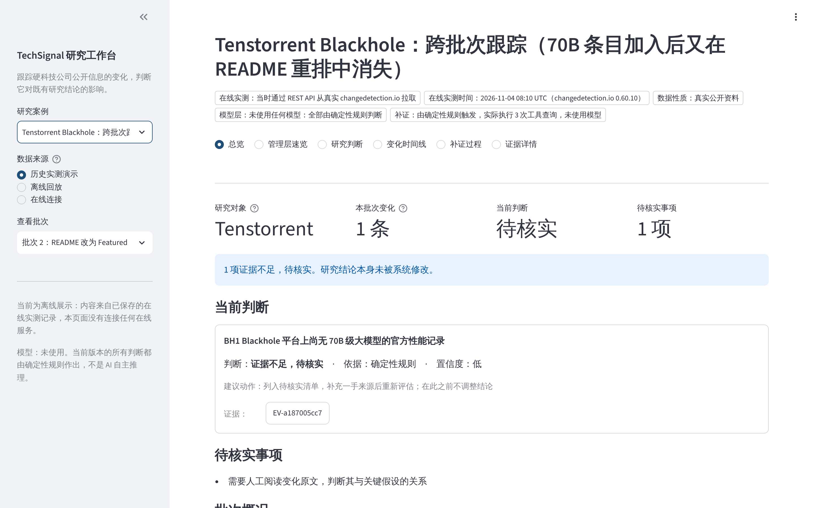
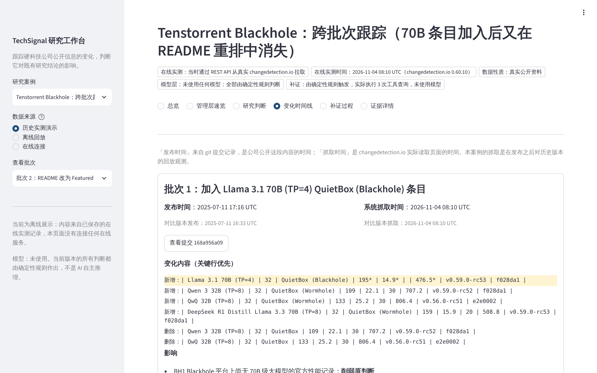
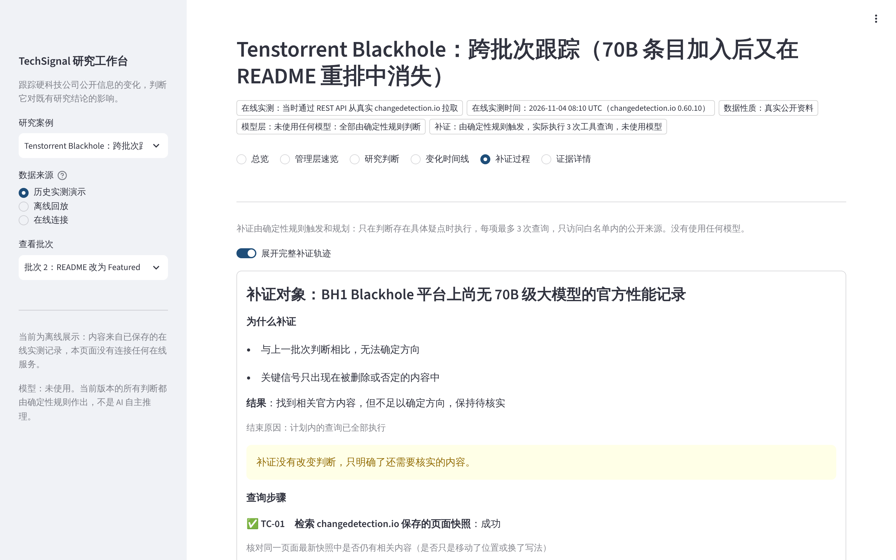

> 本文是各轮开发中积累的技术细节（数据契约、证据等级、陈述类型、补证控制等）。项目介绍见根目录 [README](../README.md)。

# TechSignal 技术参考

TechSignal 读取 [changedetection.io](https://github.com/dgtlmoon/changedetection.io) 输出的网页变化数据，判断这些变化对**既有研究判断**的影响，并生成带证据编号、可校验的中文管理层速览。

> **状态说明（R4）：** 已真实运行的部分：规则研判、证据台账、中文简报与引用校验、changedetection.io API Client、跨批次历史、**有界补证**（确定性策略，真实调用 changedetection.io 和 GitHub）、**全中文研究工作台**（浏览器界面，可离线打开真实案例）。已对真实运行的 changedetection.io 实例和真实公开来源（Tenstorrent 官方 GitHub 仓库）在线验证。**还没有任何真实大模型参与**：所有判断都由确定性规则作出；也**不是持续自动监控**，目前是按需运行和历史版本回放。详见 [docs/R4_ACCEPTANCE.md](R4_ACCEPTANCE.md)。

## 与 changedetection.io 的分工

| | changedetection.io（上游，未修改） | TechSignal（本模块） |
|---|---|---|
| 回答的问题 | 这个网页变了什么 | 这对我们的研究判断意味着什么，证据够不够 |
| 输出 | 快照、diff、通知；可选的 AI 是否重要和摘要 | 支持 / 削弱 / 无关 / 证据不足、证据等级、待核实问题、建议动作 |
| 状态 | 每个监测项独立 | 研究判断库（只读）+ 证据台账（JSONL） |

上游已有的 AI 能力（`llm_intent` 过滤、AI 变化摘要、MCP Server）属于上游，不算本模块的贡献。本模块不修改 `changedetectionio/` 下的任何文件。

## 研究工作台（R4）

```bash

pip install -e ".[ui]"
python -m techsignal.workbench          # 浏览器打开 http://localhost:8501
```

全中文的浏览器界面，共六个页面：总览、管理层速览、研究判断、变化时间线、补证过程、证据详情。默认展示真实的 Tenstorrent 历史案例，不需要网络、Docker 或模型密钥。

- **历史实测演示：** 只读展示已保存的在线实测结果。
- **离线回放：** 用保存的原始数据重新运行研判流水线，结果写入临时目录，不覆盖已保存的案例。
- **在线连接：** 连接你自己的 changedetection.io，拉取变化并研判。

可以点击证据编号跳转到该证据的详情，可以展开完整补证轨迹，可以下载中文速览。

| 总览 | 变化时间线 | 补证过程 |
|---|---|---|
|  |  |  |

## 能力演进（R1–R4）

| 轮次 | 新增的真实能力 | 仍是模拟或尚未实现 |
|---|---|---|
| R1 | 规则研判、证据台账、中文简报、引用校验、虚构场景测试 | 模型层仅有 Mock |
| R1.1 | 修复跨企业去重、失败保护、多假设归因 | — |
| R2 | changedetection.io API Client、真实实例在线验证、真实公开案例、跨批次历史 | 模型层仅有协议测试 |
| R3 | 来源声明按运行元数据生成；有界补证（真实工具、白名单、执行轨迹） | 补证决策没有使用模型 |
| R4 | 全中文研究工作台（离线可用、可交互、可回放）；修复多批次证据来源地址；简报补证记录中文化 | 持续监控、模型推理、新建判断的界面 |

## 处理流程

```
ChangesReport JSON ──▶ adapters/cdio.py   按契约校验（docs/api-spec.yaml#ChangesReport）
                      triage.py           去掉无净差异、监测报错、噪声、位置移动和重复内容（确定性）
                      store.py            证据入台账：来源、等级、cdio 追溯路径，按内容哈希编号
                      rules.py            实体与主题匹配 + 关键假设信号规则（确定性）
                      assess.py           规则能判定的直接判定；不能判定的交给模型层 Provider
                                          → 校验模型输出 → 证据等级闸门 → 来源冲突处理
                      brief.py            中文速览：每条陈述标注类型与引用
                      validate.py         引用完整性校验，不通过就不写出文件
```

**分层原则：**
- 规则层只在信号明确时判定：信号出现在新增内容里、没有否定词、所有信号方向一致。否定语境、删除内容、方向混合、只命中主题词这几种情况都交给模型层。没有配置模型时，一律判为「证据不足」。
- 模型层的输出必须引用本次变化的证据编号，并指明对应的关键假设，否则会被拒绝并降级。模型判断的置信度最高只给 medium，并且自动附带「需人工确认」。
- 证据等级闸门：只有 A（官方一手）或 B（监管文件、权威媒体）来源才能单独支撑「支持」或「削弱」。C 或 D 级来源会降级为「证据不足」，但保留初步方向。
- 来源冲突：同一条假设同时出现支持和削弱时，系统不裁决，冲突各方都降为「证据不足」，并列出冲突证据。
- 研究判断库只读：「削弱」最多只触发「建议复核」，`thesis_status_change` 恒为 `none`。
- 去重键 = 规范化内容指纹 + 研究对象（命中的 thesis 编号）。两家企业的同一段文字不会互相吞掉；同一研究对象的转载照常去重；高等级来源晚到时不会被当作重复。
- 一条变化命中多个关键假设时，逐条生成评估，不只取第一个；同一变化里支持与削弱并存时，不判方向，但会列出全部信号。
- 失败不破坏已有结果：证据台账只在校验通过后写盘；CLI 先把四个输出文件写到 `out/.techsignal-staging-*`，全部成功后再逐个 `os.replace` 到位。输入错误、校验失败、模型异常、写盘错误都以退出码 2 结束，上一次的输出保持不变。

## 快速开始

需要 Python 3.11 或以上版本。运行时依赖只有 `pydantic`，测试另需 `pytest`。不需要安装 changedetection.io 的依赖。

```bash

python -m venv .venv && . .venv/bin/activate
pip install -e ".[test]"
```

运行演示（Mock 回放）：

```bash
python -m techsignal run --changes demo/changes_report.json --theses demo/theses.json --sources demo/sources.json --provider mock --replay demo/mock_replay.json --out demo/output
```

对已生成的简报做引用校验：

```bash
python -m techsignal validate --out demo/output --theses demo/theses.json
```

跑测试：

```bash
python -m pytest
```

跑场景评测：

```bash
python -m techsignal eval
```

确认 Fixture 与上游 `changes_report.py` 的当前输出一致：

```bash
python -m techsignal.fixtures --check
```

演示输出已提交在 `demo/output/`：`brief.md`、`brief.json`、`decision_log.json`、`evidence.jsonl`。端到端测试会重新生成这些文件，并要求逐字节一致。

### 接入真实模型（R1 未验证）

`--provider openai-compatible` 会读取以下三个环境变量：`TECHSIGNAL_LLM_BASE_URL`（例如 `http://localhost:11434/v1`）、`TECHSIGNAL_LLM_MODEL` 和 `TECHSIGNAL_LLM_API_KEY`。这个 Provider 在 R1 中只用注入的假传输层测过请求构造和响应解析，**没有对任何真实模型服务运行过**。

## 在线使用：连接 changedetection.io

```bash
export TECHSIGNAL_CDIO_API_KEY=...   # changedetection.io 设置页中的 API key；只从环境变量读取
python -m techsignal run --cdio-url http://localhost:5000 --from 1790812800 --theses my/theses.json --sources my/sources.json --out out/
```

可选参数：`--to`、`--tag`、`--uuids`、`--page-size`、`--max-lines`、`--timeout`。在线模式会额外写出 `source_changes_report.json`（原始响应）和 `run_record.json`（地址、参数、拉取时间、响应 sha256，不含密钥）。

加上 `--track-history` 进入跨批次模式：证据台账和 `judgements.jsonl` 会累积；新证据与同一假设的历史判断方向相反时，降级并列出冲突证据；简报会说明每个假设「之前 → 现在」的变化，研究结论本身不会被改动。

真实实例端到端（需要装有 changedetection.io 依赖的 Python）：

```bash
python -m techsignal.live --python /path/to/python --case cases/tenstorrent_blackhole/case.json --out /tmp/out
```

真实公开案例：[cases/tenstorrent_blackhole/](../cases/tenstorrent_blackhole/README.md)。

## 有界补证（R3）

```bash
python -m techsignal run --cdio-url http://localhost:5000 --from 1790812800 --theses ... --sources ... --out out/ --track-history --verify --verify-policy my/verify_policy.json
```

- **何时触发：** 只在研判存在具体疑点时补证——信号只出现在删除或否定语境中、有冲突证据、低等级来源带方向、跨批次无法定向。裁定明确的研判和无关变化不触发。
- **用什么工具：** changedetection.io 快照检索（只限本次 `--cdio-url` 实例）、GitHub 指定版本的文件检索、GitHub 提交元数据。规划由确定性代码完成：同页最新快照 → 引起变化的提交 → 疑点内容中的官方相对链接。
- **控制：** 白名单（主机、端口、路径前缀完全匹配，每跳重定向都重新检查）；每项最多 3 次调用，另有每次运行的总上限；超时、重试、调用去重和停止条件；工具输出只当作数据，疑似提示注入的行会被排除。
- **结果：** 新证据独立编号（`obtained_via=verification_tool`），交给同一套规则复评；没有命中规则就保持「尚未核实」。每次调用都写入 `verification_trace.json`，简报中有「补证记录」一节。
- **结论只读：** 研究判断永远不会被改写；补证失败时，已有输出、台账和历史保持不变。

## 来源声明

简报开头的声明都根据运行元数据生成（`provenance.py`），包括：在线拉取或离线文件；离线回放必须用 `--input-record` 提供在线运行记录并核对 sha256；数据是虚构还是公开资料；模型层是未配置、Mock 回放还是真实模型；是否执行了补证。

## changedetection.io 数据契约

适配器解析的是 `GET /api/v1/changes?format=json` 的返回。契约依据：
- `changedetectionio/api/Changes.py`
- `changedetectionio/changes_report.py`：`group_changes()` 和 `watch_changes()`
- `docs/api-spec.yaml`：`components.schemas.ChangesReport`

Fixture 不是手写的，而是 `techsignal/fixtures.py` 按文件路径加载上游 `changes_report.py`（它只依赖标准库），用最小的替身 Watch 对象调用真实的 `group_changes()` 生成。快照文本是人工虚构的。在线 HTTP 拉取和 Webhook 接收尚未实现。

追溯：每条证据都记录了 `cdio_difference_path`，即 `/api/v1/watch/{uuid}/difference/{from}/{to}`，在真实部署中可以用它回查原始差异。

## 证据等级与陈述类型

| 等级 | 含义 |
|---|---|
| A | 公司官方一手披露 |
| B | 监管文件或权威媒体 |
| C | 二手转述或第三方分析 |
| D | 未经证实，包括论坛、匿名来源和未登记域名（默认值） |

| 陈述类型 | 校验规则 |
|---|---|
| fact（事实） | 必须引用台账中存在的证据 |
| inference（判断） | 必须引用证据，否则只能写成 speculation |
| speculation（推测） | 渲染时标注「推测，无证据支撑」 |
| context（历史结论） | 必须引用存在的研究判断编号 |
| question / action | 待核实问题、建议动作 |

Markdown 层还会检查：所有 `[EV-…]`、`[TH-…]` 都能追溯到证据或研究判断；「新增信息」「来源」「证据等级」下的每一行都带证据编号；使用了 Mock 时必须有披露声明。

## 测试

离线测试共 216 个（其中 31 个为工作台测试，界面脚本测试需要安装 `.[ui]`），另有 4 个需显式开启的在线测试（`tests/integration/`，需要真实的 changedetection.io 和 GitHub 访问）。离线测试包括 23 个虚构场景（S21–S23 和 `test_r11_*.py` 为 R1.1 反例回归），以及 R2 新增的 API Client、真实案例回放、模型协议、跨批次测试。场景覆盖：有效变化、支持、削弱、两类无关、两类噪声、两类重复、来源冲突、低等级证据、无信号、Mock 判定、模型错误引用、模型缺失、否定语境、无净差异、截断加报错，以及三类异常输入。各场景的结果见 [docs/R1_ACCEPTANCE.md](R1_ACCEPTANCE.md)。

评测指标只说明代码行为与人工标注的预期一致。场景和预期都由开发者编写，**不代表真实世界的准确率**。

## 已知局限

- 信号规则是分析师手写的正则，存在漏判。开发中实际遇到过一次：「取消向澜芯光电采购 1.6T 光模块的订单」超出了原先 12 字的匹配窗口。
- 实体匹配用的是子串匹配，没有消歧（例如同名公司）。
- 噪声规则把只有数字的行也视为噪声，对价格类页面不适用。
- 去重只识别规范化后完全相同的内容，不识别同义改写。
- 「研究对象」目前以 thesis 为粒度：若一条 thesis 跟踪多家公司，这些公司之间的同文内容仍会被视为重复。实体级标准 ID 留待后续。
- 输出提交是逐文件原子的，四个文件作为一组并非原子：进程恰好在两次 `os.replace` 之间被杀时可能新旧混合。已按「台账先、brief.md 最后」排序，降低影响。
- 补证决策和研判没有使用大模型；检索只能做词语和正则匹配，无法理解表格以外的语义。
- 不是持续自动监控：没有定时任务和通知；研究判断、规则和白名单都要手写 JSON。
- 没有结论版本管理；研究判断只读，修改要由人来做。

## 许可与署名

本模块以 Apache-2.0 发布，构建在 changedetection.io（Apache-2.0，Copyright Leigh Morresi and contributors）之上，以 API 数据契约集成，未修改其源代码。按照上游 `NOTICE`，changedetection.io 的名称和 Logo 不在授权范围内，本项目不使用其品牌。
